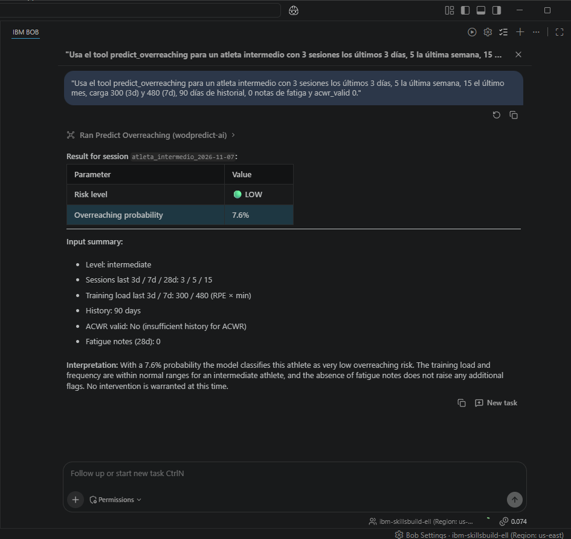
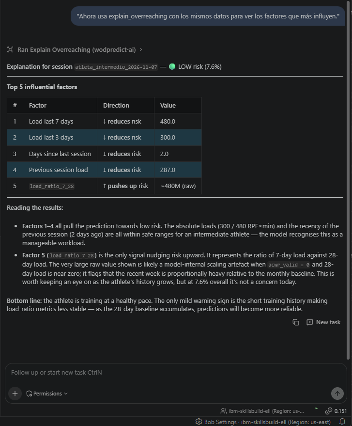
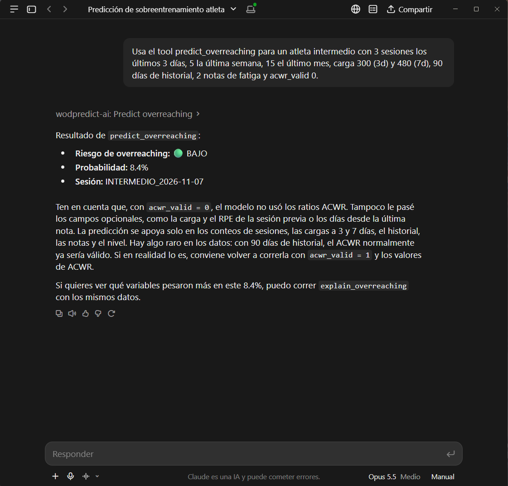
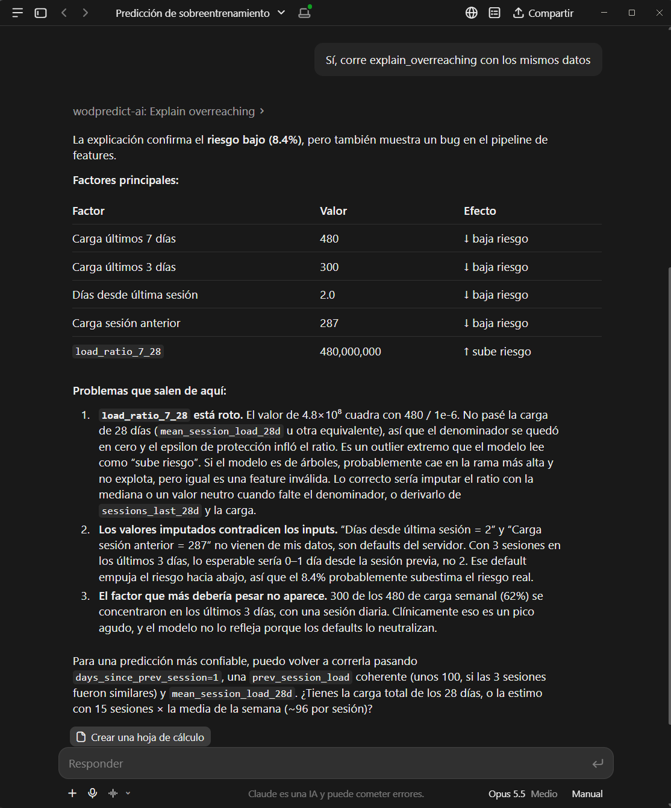
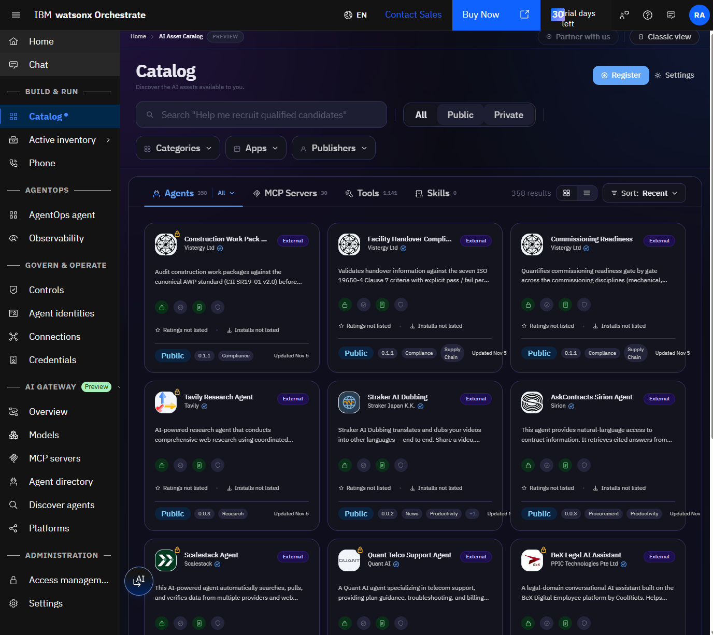
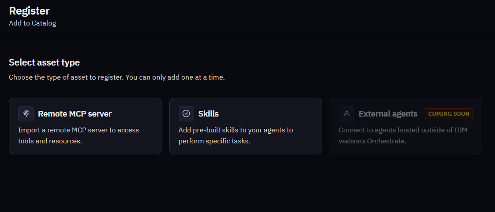
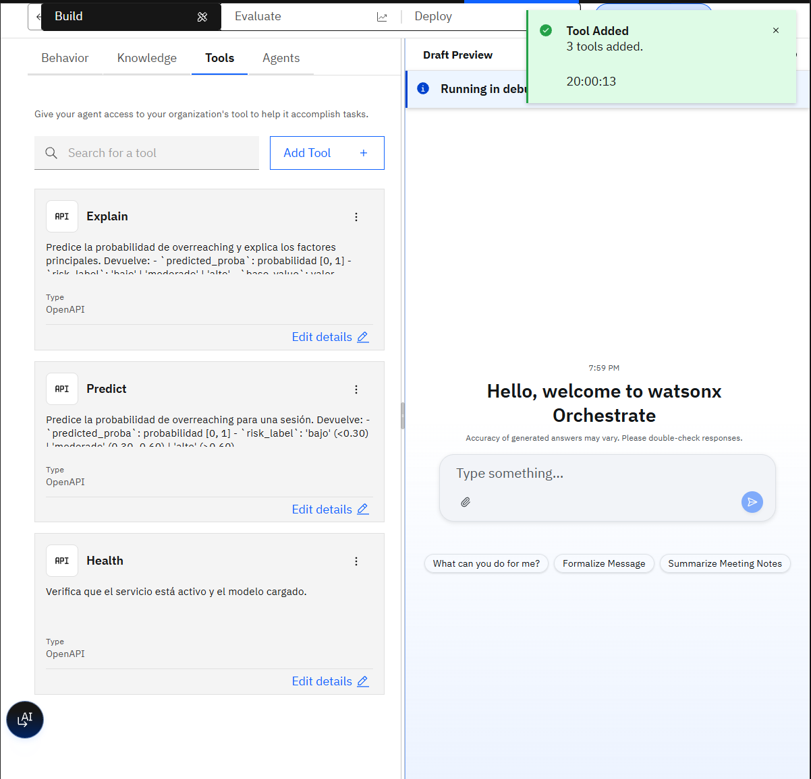
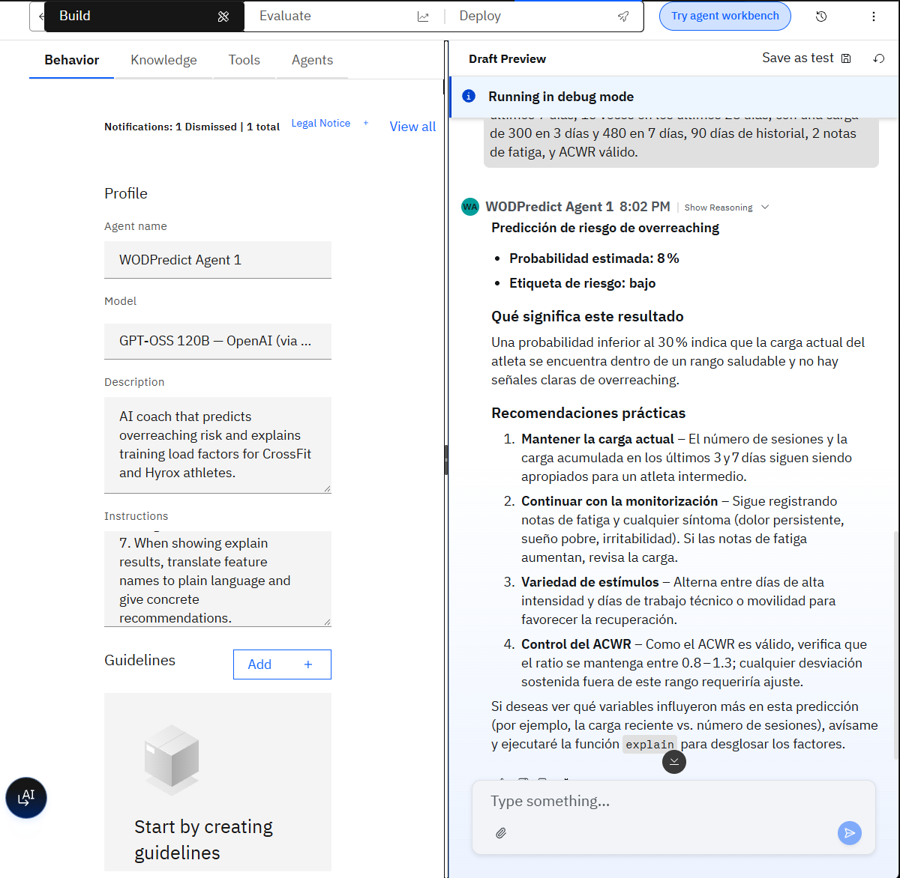
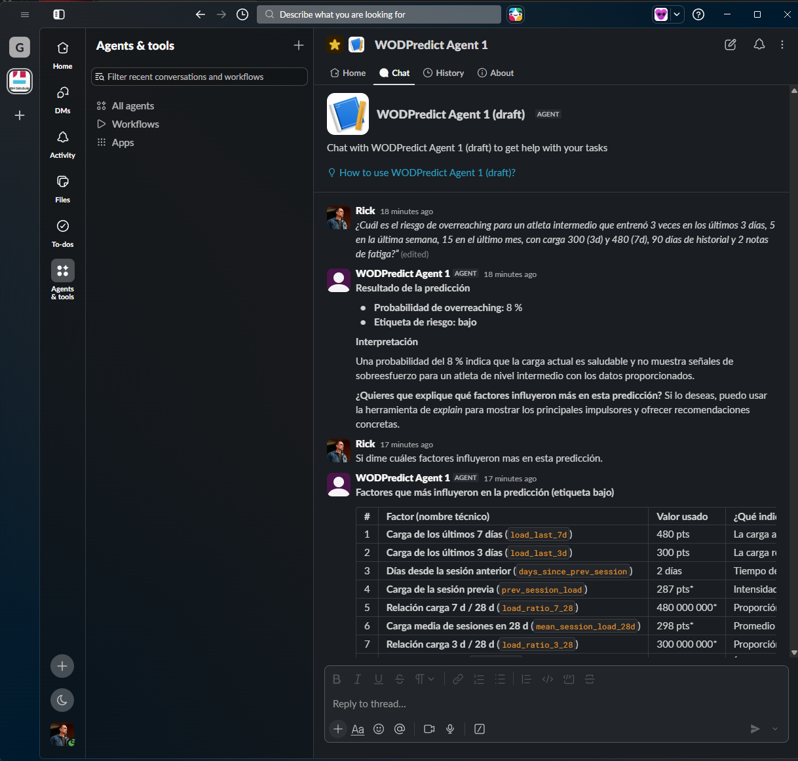
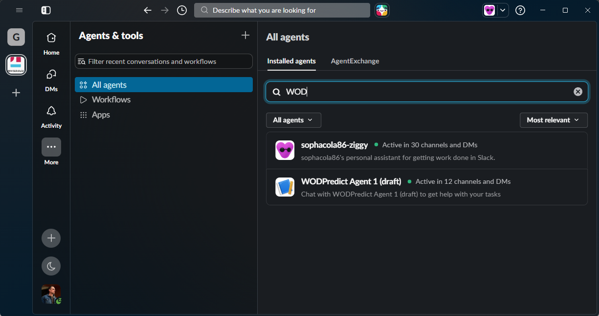

# WODPredict-AI
### [IBM SkillsBuild AI Experiential Learning Lab | Mexico 2026](https://skills.yourlearning.ibm.com/activity/PLAN-DB5D02B88AA5)

Predicción de **overreaching** (sobreentrenamiento) y prescripción adaptativa de cargas para atletas de **CrossFit**, implementado como una API REST con explicabilidad SHAP y un servidor MCP para integración con agentes de IA.

El modelo fue expuesto como un **agente conversacional en watsonx Orchestrate**, conectado a **Slack (IBM SkillsBuild)** para validar su funcionamiento en vivo: entrenadores y atletas podían consultar el riesgo de sobreentrenamiento y recibir explicaciones SHAP en lenguaje natural directamente desde el canal `#wodpredict-ai`, sin escribir una sola línea de código.


---

## 🚀 Quick Start — Docker (sin instalar nada)

> El modelo va **embebido en la imagen**. No se necesitan tokens ni cuentas externas.

```bash
# 1. Clonar
git clone https://github.com/tu-usuario/wodpredict-ai.git
cd wodpredict-ai

# 2. Construir y arrancar
docker compose up --build

# 3. Verificar
curl http://localhost:8080/health
```

O con Docker directamente:

```bash
docker build -t wodpredict-ai .
docker run --rm -p 8080:8080 wodpredict-ai
curl http://localhost:8080/health
```

**Respuesta esperada:**

```json
{ "status": "ok", "model_loaded": true, "model_version": "0.1.0" }
```

---

## Tabla de contenidos

1. [Descripción del problema](#descripción-del-problema)
2. [Arquitectura](#arquitectura)
3. [Tecnologías utilizadas](#tecnologías-utilizadas)
4. [Estructura del proyecto](#estructura-del-proyecto)
5. [Instalación local (sin Docker)](#instalación-local-sin-docker)
5. [Uso rápido — API REST](#uso-rápido--api-rest)
6. [Endpoints](#endpoints)
7. [Features del modelo](#features-del-modelo)
8. [Servidor MCP (integración con agentes IA)](#servidor-mcp-integración-con-agentes-ia)
9. [Monitoreo y reentrenamiento](#monitoreo-y-reentrenamiento)
10. [Deploy con Docker / IBM Code Engine](#deploy-con-docker--ibm-code-engine)
11. [Tests](#tests)
12. [Integración con watsonx Orchestrate](#integración-con-watsonx-orchestrate)
13. [Herramientas IBM utilizadas](#herramientas-ibm-utilizadas)
14. [Licencia](#licencia)

---

## Descripción del problema

El overreaching funcional ocurre cuando un atleta acumula más carga de entrenamiento de la que puede recuperar. Si no se detecta a tiempo, puede derivar en lesiones o sobreentrenamiento crónico.

WODPredict-AI analiza el historial de carga y las señales subjetivas de fatiga del atleta para estimar la probabilidad de overreaching en cada sesión, y explica **qué factores** están impulsando ese riesgo.

---

## Arquitectura

```
Dataset (HuggingFace)
        │
        ▼
┌──────────────────┐     ┌──────────────────┐     ┌──────────────────┐
│  Ingestion       │────▶│  Features        │────▶│  Model           │
│  loader + schema │     │  builder (29 ft) │     │  XGBoost + SHAP  │
└──────────────────┘     └──────────────────┘     └──────────────────┘
                                                          │
                                    ┌─────────────────────┼─────────────────────┐
                                    ▼                     ▼                     ▼
                            ┌──────────────┐   ┌──────────────────┐   ┌──────────────────┐
                            │  FastAPI     │   │  MCP Server      │   │  Monitoring      │
                            │  /health     │   │  predict_tool    │   │  DriftDetector   │
                            │  /predict    │   │  explain_tool    │   │  AutoRetrainer   │
                            │  /explain    │   │  health_check    │   └──────────────────┘
                            └──────────────┘   └──────────────────┘
                                    │
                            ┌──────────────┐
                            │  Docker      │
                            │  IBM Code    │
                            │  Engine      │
                            └──────────────┘
```

---

## Tecnologías utilizadas

| Categoría | Tecnología | Detalle |
|---|---|---|
| **Lenguaje** | Python 3.12 | Tipado estático con `from __future__ import annotations` en todos los módulos |
| **Entorno de desarrollo** | IBM Bob + VS Code | Bob como asistente de IA para arquitectura, código, tests y documentación; extensiones Python, Docker y Jupyter |
| **Modelo** | XGBoost 2.0 (clasificación binaria) | 29 features; imputación con medianas del training set; artefactos en JSON |
| **Explicabilidad** | SHAP 0.45 | `TreeExplainer`; top-N drivers con dirección y valor de feature por predicción |
| **Feature engineering** | scikit-learn + pandas | Pipeline de 20 features base + 9 derivadas (ratios ACWR, señal de fatiga, encoding ordinal) |
| **API** | FastAPI + Pydantic v2 + uvicorn | REST/JSON; OpenAPI auto-generado; validación de entrada y salida con modelos Pydantic |
| **Agente conversacional** | watsonx Orchestrate | Agente WODPredict Agent 1 (GPT-OSS 120B); 3 skills OpenAPI registrados en catálogo de organización |
| **Canal de validación** | Slack — IBM SkillsBuild | Workspace `#wodpredict-ai`; prueba en vivo con usuarios reales sin código |
| **Servidor MCP** | FastMCP (Python) | 3 tools (`predict_overreaching`, `explain_overreaching`, `health_check`) para cualquier agente MCP-compatible |
| **Túnel HTTP** | ngrok | Exposición pública temporal de la API local para conectar con watsonx Orchestrate |
| **Contenedor** | Docker — multi-stage build | `python:3.12-slim`; stage builder + runtime; modelo embebido en la imagen; no requiere GPU |
| **Orquestación local** | Docker Compose | `docker compose up --build` levanta la API lista para usar |
| **Nube (target)** | IBM Code Engine + IBM Container Registry | Deploy serverless documentado; imagen en `us.icr.io/wodpredict/wodpredict-ai` |
| **Tests** | pytest | 141 tests en 6 módulos; cobertura de ingesta, features, modelo, SHAP, API y monitoreo |
| **Detección de drift** | SciPy (KS test) + PSI | `DriftDetector` + `AutoRetrainer`; reentrenamiento automático cuando se detecta drift severo |
| **Dataset** | HuggingFace Hub | Cargado vía `huggingface_hub`; contratos de validación con Pydantic |
| **Dependencias** | `requirements.txt` | Solo dependencias de producción (sin herramientas de entrenamiento) |

---

## Estructura del proyecto

```
wodpredict-ai/
├── config.py                       # Rutas de artefactos (MODEL_PATH, MEDIANS_PATH)
├── Dockerfile                      # Multi-stage build: builder + runtime slim
├── docker-compose.yml              # Levanta la API con un solo comando
├── requirements.txt                # Dependencias de producción (sin training)
│
├── ingestion/
│   ├── loader.py                   # Carga desde HuggingFace, devuelve DatasetBundle
│   └── schema.py                   # Contratos Pydantic, normalización unicodedata
│
├── features/
│   └── builder.py                  # 29 features (20 base + 9 derivadas), FeatureMatrix
│
├── model/
│   ├── trainer.py                  # Entrenamiento XGBoost, cross-validation
│   └── artifacts/
│       ├── xgb_overreaching.json   # Modelo entrenado
│       └── imputation_medians.json # Medianas para imputación de NaN
│
├── explainability/
│   └── shap_explainer.py           # SHAPExplainer, LocalExplanation, top-N drivers
│
├── api/
│   └── main.py                     # FastAPI app: /health, /predict, /explain
│
├── monitoring/
│   ├── drift.py                    # DriftDetector: KS test + PSI por feature
│   └── retrainer.py                # AutoRetrainer: ciclo detect → retrain → evaluate
│
├── wodpredict_mcp/
│   ├── server.py                   # Servidor MCP: 3 tools para agentes de IA
│   └── mcp-config.json             # Configuración para Bob MCP
│
├── screenshots/                    # Capturas de la integración con watsonx Orchestrate
│
└── tests/
    ├── test_ingestion.py           # 24 tests
    ├── test_features.py            # 23 tests
    ├── test_model.py               # 17 tests
    ├── test_shap.py                # 25 tests
    ├── test_api.py                 # 23 tests
    └── test_monitoring.py          # 29 tests (141 total)
```

---

## Instalación local (sin Docker)

### Prerrequisitos

- Python 3.12+
- Conda (recomendado) o virtualenv

### Con Conda

```bash
conda create -n wodpredict python=3.12 -y
conda activate wodpredict
pip install -r requirements.txt
```

### Variables de entorno

| Variable | Default | Descripción |
|---|---|---|
| `PORT` | `8080` | Puerto en el que escucha uvicorn |
| `WODPREDICT_API_URL` | `http://localhost:8001` | URL que usa el servidor MCP para llamar a la API |

> No se requieren tokens ni claves de API para correr la API y el servidor MCP localmente.

---

## Uso rápido — API REST

### Arrancar la API localmente

```bash
uvicorn api.main:app --reload --port 8080
```

### Ejemplo de predicción

```bash
curl -X POST http://localhost:8080/predict \
  -H "Content-Type: application/json" \
  -d '{
    "session_id": "A0001_2025-03-01",
    "sessions_last_3d": 2,
    "sessions_last_7d": 4,
    "sessions_last_28d": 14,
    "load_last_3d": 240,
    "load_last_7d": 420,
    "acwr_valid": 1,
    "days_since_first_session": 90,
    "notes_last_28d": 3,
    "level": "intermedio"
  }'
```

Respuesta:

```json
{
  "session_id": "A0001_2025-03-01",
  "predicted_proba": 0.2153,
  "risk_label": "bajo",
  "model_version": "0.1.0"
}
```

---

## Endpoints

### `GET /health`

Verifica el estado del servicio.

```json
{
  "status": "ok",
  "model_loaded": true,
  "model_version": "0.1.0"
}
```

---

### `POST /predict`

Predice la probabilidad de overreaching para una sesión.

**Request body** (`SessionFeaturesRequest`):

| Campo | Tipo | Requerido | Descripción |
|---|---|---|---|
| `session_id` | string | ✅ | Identificador único (ej. `"A0001_2025-03-01"`) |
| `sessions_last_3d` | float | ✅ | Sesiones en los últimos 3 días |
| `sessions_last_7d` | float | ✅ | Sesiones en los últimos 7 días |
| `sessions_last_28d` | float | ✅ | Sesiones en los últimos 28 días |
| `load_last_3d` | float | ✅ | Carga (RPE × min) últimos 3 días |
| `load_last_7d` | float | ✅ | Carga (RPE × min) últimos 7 días |
| `acwr_valid` | int (0/1) | ✅ | 1 si hay suficiente historial para calcular ACWR |
| `days_since_first_session` | int | ✅ | Días desde la primera sesión registrada |
| `notes_last_28d` | int | ✅ | Notas de fatiga subjetiva en 28 días |
| `level` | string | ✅ | `"novato"`, `"intermedio"` o `"elite"` |
| `days_since_prev_session` | float | ⬜ | Días desde la sesión anterior |
| `mean_session_load_28d` | float | ⬜ | Carga media por sesión en 28 días |
| `acwr3_freq` / `acwr3_load` | float | ⬜ | ACWR de 3 días (frecuencia / carga) |
| `acwr_freq` / `acwr_load` | float | ⬜ | ACWR de 7 días (frecuencia / carga) |
| `prev_rpe` | float [1–11] | ⬜ | RPE de la sesión anterior |
| `prev_session_load` | float | ⬜ | Carga de la sesión anterior |
| `prev_has_note` | float (0/1) | ⬜ | 1 si la sesión anterior tiene nota |
| `prob_fatiga_prev_session` | float [0–1] | ⬜ | Probabilidad de fatiga en sesión previa |
| `prob_fatiga_last_note` | float [0–1] | ⬜ | Probabilidad de fatiga en última nota |
| `days_since_last_note` | float | ⬜ | Días desde la última nota de fatiga |

> Los campos opcionales (⬜) se imputarán con las medianas del training set si se omiten.

**Response** (`PredictResponse`):

| Campo | Tipo | Descripción |
|---|---|---|
| `session_id` | string | Mismo ID enviado |
| `predicted_proba` | float | Probabilidad de overreaching [0, 1] |
| `risk_label` | string | `"bajo"` (<0.30) \| `"moderado"` (0.30–0.60) \| `"alto"` (>0.60) |
| `model_version` | string | Versión del modelo |

---

### `POST /explain`

Igual que `/predict` pero devuelve además la explicación SHAP con los top-8 drivers.

**Response adicional** (`ExplainResponse`):

| Campo | Tipo | Descripción |
|---|---|---|
| `base_value` | float | Valor esperado del modelo (línea base SHAP) |
| `top_drivers` | array | Top-8 features con `feature`, `shap_value` y `feature_value` |

`shap_value > 0` → empuja hacia overreaching  
`shap_value < 0` → reduce el riesgo

---

## Features del modelo

El modelo usa **29 features** en total:

**20 features base** (del dataset):
`days_since_prev_session`, `sessions_last_3d`, `sessions_last_7d`, `sessions_last_28d`, `load_last_3d`, `load_last_7d`, `mean_session_load_28d`, `acwr3_freq`, `acwr3_load`, `acwr_freq`, `acwr_load`, `acwr_valid`, `days_since_first_session`, `prev_rpe`, `prev_session_load`, `prev_has_note`, `prob_fatiga_prev_session`, `prob_fatiga_last_note`, `days_since_last_note`, `notes_last_28d`

**9 features derivadas** (calculadas por `features.builder`):

| Feature | Fórmula / Lógica |
|---|---|
| `level_enc` | Ordinal: novato=0, intermedio=1, elite=2 |
| `load_ratio_3_28` | `load_last_3d / (mean_session_load_28d + ε)` |
| `load_ratio_7_28` | `load_last_7d / (mean_session_load_28d × 4 + ε)` |
| `freq_ratio_3_7` | `sessions_last_3d / (sessions_last_7d + ε)` |
| `fatigue_signal` | Media de `prob_fatiga_prev_session` y `prob_fatiga_last_note` |
| `days_since_note_capped` | `days_since_last_note` truncado a 28 días |
| `acwr_load_risk` | 1 si `acwr_load > 1.3` |
| `acwr_freq_risk` | 1 si `acwr_freq > 1.3` |
| `prev_rpe_norm` | `prev_rpe / 10` (normalizado a [0, 1]) |

---

## Servidor MCP (integración con agentes IA)

El servidor MCP expone las capacidades de la API como **tools** que cualquier agente de IA compatible con el protocolo MCP puede invocar en lenguaje natural. El diseño es **agnóstico al agente**: el mismo servidor funciona con IBM Bob, Claude Desktop, Cursor o cualquier cliente MCP — sin modificar una sola línea de código.

### Tools disponibles

| Tool | Descripción |
|---|---|
| `predict_overreaching` | Probabilidad de overreaching + nivel de riesgo |
| `explain_overreaching` | Probabilidad + top-N factores SHAP en lenguaje natural |
| `health_check` | Verifica que la API FastAPI está activa |

### Arrancar el servidor MCP

```bash
# La API debe estar corriendo primero
uvicorn api.main:app --port 8001

# En otra terminal:
WODPREDICT_API_URL=http://localhost:8001 python -m wodpredict_mcp.server
```

### Conectar con Bob (IBM Bob)

En Bob: **Settings → MCP → `+` → Open Configuration File** y añade:

```json
{
  "mcpServers": {
    "wodpredict-ai": {
      "command": "<ruta-al-python-del-entorno>",
      "args": ["-m", "wodpredict_mcp.server"],
      "cwd": "<ruta-al-proyecto>",
      "env": {
        "WODPREDICT_API_URL": "http://localhost:8002"
      }
    }
  }
}
```

> **Nota:** Usa el ejecutable `python.exe` del entorno virtual directamente (no `conda run`). En Windows con Conda:
> `"command": "D:\\Miniconda3\\envs\\wodpredict\\python.exe"`
> Obtén la ruta exacta con: `conda run -n wodpredict python -c "import sys; print(sys.executable)"`

### Interoperabilidad — agentes compatibles

El protocolo MCP es un estándar abierto. El mismo servidor `wodpredict_mcp/server.py` puede conectarse a cualquiera de estos clientes:

| Cliente MCP | Canal de uso | Estado |
|---|---|---|
| **IBM Bob** | Chat de desarrollo / asistente de código | ✅ Documentado y probado |
| **watsonx Orchestrate** | Agente en Slack (IBM SkillsBuild) | ✅ Demostrado en producción |
| **Claude Desktop** | Chat local con Anthropic Claude | ✅ Compatible (ver config abajo) |
| **Cursor** | Editor de código con agente IA | ✅ Compatible (misma config que Claude) |
| **Cualquier cliente MCP** | SDK oficial Python / Node.js | ✅ Protocolo abierto |

### Conectar con Claude Desktop

1. Descarga [Claude Desktop](https://claude.ai/download) si no lo tienes instalado.
2. Abre el archivo de configuración:
   - **macOS:** `~/Library/Application Support/Claude/claude_desktop_config.json`
   - **Windows:** `%APPDATA%\Claude\claude_desktop_config.json`
3. Añade la entrada del servidor:

```json
{
  "mcpServers": {
    "wodpredict": {
      "command": "conda",
      "args": ["run", "-n", "wodpredict", "python", "-m", "wodpredict_mcp.server"],
      "cwd": "C:/ruta/al/proyecto/wodpredict-ai",
      "env": {
        "WODPREDICT_API_URL": "http://localhost:8001"
      }
    }
  }
}
```

4. Asegúrate de que la API está corriendo (`uvicorn api.main:app --port 8001`) y reinicia Claude Desktop.
5. Verás el ícono 🔌 en el chat — los tools `predict_overreaching`, `explain_overreaching` y `health_check` estarán disponibles.

Pregunta de ejemplo para Claude:
> *"Usa el tool de WODPredict para calcular el riesgo de un atleta intermedio con 3 sesiones en los últimos 3 días, 5 en la última semana, 15 en el último mes, carga 300 (3d) y 480 (7d), 90 días de historial y 2 notas de fatiga."*

### Demo — IBM Bob invocando los tools MCP

**Predicción de overreaching (`predict_overreaching`):**



Bob invoca el tool `predict_overreaching` de `wodpredict-ai`, obtiene una probabilidad de **7.6%** (riesgo LOW) e interpreta el resultado en lenguaje natural: carga y frecuencia dentro de rangos normales para un atleta intermedio, sin señales de sobresfuerzo.

**Explicación SHAP (`explain_overreaching`):**



Con `explain_overreaching`, Bob muestra los **Top 5 factores SHAP** que explican la predicción:

| # | Factor | Dirección | Valor |
|---|---|---|---|
| 1 | Load last 7 days | ↓ reduces risk | 480 RPE×min |
| 2 | Load last 3 days | ↓ reduces risk | 300 RPE×min |
| 3 | Days since last session | ↓ reduces risk | 2 días |
| 4 | Previous session load | ↓ reduces risk | 287 RPE×min |
| 5 | `load_ratio_7_28` | ↑ pushes up risk | ~480M (raw) |

Bob interpreta cada factor en contexto: los primeros 4 confirman una carga saludable; el factor 5 advierte que la proporción de carga reciente vs. mensual es alta debido al historial corto (28 días aún en construcción).

### Demo — Claude Desktop invocando los tools MCP

**Predicción de overreaching (`predict_overreaching`):**



Claude invoca el tool `predict_overreaching`, recibe **🟢 BAJO — 8.4%** con session_id generado automáticamente (`INTERMEDIO_2026-11-07`) e interpreta el contexto clínico: señala que con `acwr_valid=0` el modelo no usó ratios ACWR y sugiere re-correr con `acwr_valid=1` para mayor precisión.

**Explicación SHAP (`explain_overreaching`):**



Claude muestra los Top 5 factores SHAP e identifica de forma autónoma un comportamiento del modelo: el factor `load_ratio_7_28` recibe un valor extremo (~480M) cuando `mean_session_load_28d` no se proporciona y el denominador queda cerca de cero. Esto demuestra que el agente no solo consume el tool sino que **razona sobre la calidad de la predicción** y sugiere datos adicionales para mejorarla.

---

## Monitoreo y reentrenamiento

### Detección de drift (`monitoring.drift`)

Detecta cambios estadísticos en la distribución de las features entre el training set y los datos en producción.

```python
from monitoring.drift import DriftDetector

detector = DriftDetector.from_feature_matrix(fm_train)
report   = detector.detect(X_new, save_report=True)

if report.has_drift:
    print(report.summary())
    # Features con drift: ['acwr_load', 'load_last_7d', ...]
```

**Métodos de detección:**

| Método | Umbral | Descripción |
|---|---|---|
| KS test | p < 0.05 | Diferencia significativa en distribución continua |
| PSI moderado | PSI ≥ 0.10 | Cambio notable en la distribución |
| PSI severo | PSI ≥ 0.20 | Cambio severo — reentrenamiento urgente |

### Reentrenamiento automático (`monitoring.retrainer`)

```python
from monitoring.retrainer import AutoRetrainer

retrainer = AutoRetrainer(detector, model_path="model/artifacts/xgb_overreaching.json")
result    = retrainer.run(X_new, y_new)

if result.retrained:
    print(f"Modelo reentrenado. AUC: {result.new_auc:.4f}")
```

---

## Deploy con Docker / IBM Code Engine

### Construir la imagen

```bash
docker build -t wodpredict-ai:latest .
```

### Correr localmente

```bash
docker run --rm -p 8080:8080 wodpredict-ai:latest
curl http://localhost:8080/health
```

### Con Docker Compose

```bash
docker compose up --build
```

### Push a IBM Container Registry

```bash
ibmcloud cr login
docker tag wodpredict-ai:latest us.icr.io/wodpredict/wodpredict-ai:latest
docker push us.icr.io/wodpredict/wodpredict-ai:latest
```

### Deploy en IBM Code Engine

```bash
ibmcloud ce app create \
  --name wodpredict-api \
  --image us.icr.io/wodpredict/wodpredict-ai:latest \
  --port 8080 \
  --min-scale 1 \
  --max-scale 3 \
  --cpu 1 \
  --memory 4G
```

La URL pública se obtiene con:

```bash
ibmcloud ce app get --name wodpredict-api --output url
```

---

## Tests

141 tests en total, organizados por módulo:

```bash
# Todos los tests
pytest tests/ -v

# Por módulo
pytest tests/test_ingestion.py   # 24 tests — carga y validación de esquema
pytest tests/test_features.py    # 23 tests — feature engineering
pytest tests/test_model.py       # 17 tests — entrenamiento y métricas XGBoost
pytest tests/test_shap.py        # 25 tests — explicabilidad SHAP
pytest tests/test_api.py         # 23 tests — endpoints FastAPI
pytest tests/test_monitoring.py  # 29 tests — drift detection y reentrenamiento
```

| Módulo | Tests | Estado |
|---|---|---|
| Ingesta + validación | 24 | ✅ |
| Feature engineering | 23 | ✅ |
| Modelo XGBoost | 17 | ✅ |
| Explicabilidad SHAP | 25 | ✅ |
| API FastAPI | 23 | ✅ |
| Monitoreo + reentrenamiento | 29 | ✅ |
| **Total** | **141** | **✅** |

---

## Integración con watsonx Orchestrate

> **Nota:** Esta integración fue realizada con una cuenta de prueba de watsonx Orchestrate (trial de 30 días). Las capturas a continuación muestran la integración funcional completa, incluyendo el agente activo en Slack. Para replicarla se requiere una cuenta de [watsonx Orchestrate](https://www.ibm.com/products/watsonx-orchestrate). La API REST y el servidor MCP son completamente funcionales de forma independiente.

El agente **WODPredict Agent 1** está desplegado en watsonx Orchestrate y expuesto en Slack.



### Arquitectura de integración

```
uvicorn api.main:app --port 8001
        │
        ▼
ngrok http 8001  ──►  https://<tunnel>.ngrok-free.dev  (URL pública)
        │
        ▼
watsonx Orchestrate — Tools (OpenAPI)
        ├── Predict  POST /predict
        ├── Explain  POST /explain
        └── Health   GET  /health
        │
        ▼
WODPredict Agent 1  (GPT-OSS 120B — OpenAI)
        │
        ▼
Slack — IBM SkillsBuild workspace
        └── #wodpredict-ai
```

### Skills registrados en el catálogo



| Skill | Método | Descripción |
|---|---|---|
| `predict` | POST `/predict` | Probabilidad de overreaching [0–1] + risk_label |
| `explain` | POST `/explain` | Probabilidad + top-8 SHAP drivers con valores |
| `health` | GET `/health` | Estado del servicio y modelo |

El skill está publicado en el catálogo de la organización como **`wodpredict-ai` v1.0.0** (categoría: Healthcare).



### Configuración del agente

| Campo | Valor |
|---|---|
| **Nombre** | WODPredict Agent 1 |
| **Modelo LLM** | GPT-OSS 120B — OpenAI |
| **Canal** | Slack — IBM SkillsBuild |
| **Estado** | Live ✅ (durante el período de trial) |

### Ejemplo de interacción real (Slack)



**Usuario:**
> ¿Cuál es el riesgo de overreaching para un atleta intermedio que entrenó 3 veces en los últimos 3 días, 5 en la última semana, 15 en el último mes, con carga 300 (3d) y 480 (7d), 90 días de historial y 2 notas de fatiga?

**Agente → tool `predict`:**
- Probabilidad de overreaching: **8%**
- Etiqueta de riesgo: **bajo**
- *"Una probabilidad del 8% indica que la carga actual es saludable y no muestra señales de sobresfuerzo para un atleta de nivel intermedio."*

**Usuario:** *"Dime cuáles factores influyeron más en esta predicción."*

**Agente → tool `explain` — Top 8 SHAP drivers:**



| # | Factor | Valor |
|---|---|---|
| 1 | Carga de los últimos 7 días (`load_last_7d`) | 480 pts |
| 2 | Carga de los últimos 3 días (`load_last_3d`) | 300 pts |
| 3 | Días desde la sesión anterior (`days_since_prev_session`) | 2 días* |
| 4 | Carga de la sesión previa (`prev_session_load`) | 287 pts* |
| 5 | Relación carga 7d/28d (`load_ratio_7_28`) | 480,000 |
| 6 | Carga media de sesiones en 28d (`mean_session_load_28d`) | 298 pts* |
| 7 | Relación carga 3d/28d (`load_ratio_3_28`) | 300,000 |
| 8 | ACWR 3d carga (`acwr3_load`) | 0.90* |

*\* Valores inferidos por el modelo (imputación con medianas del training set).*



### Replicar la integración con Orchestrate

> Requiere una cuenta de [watsonx Orchestrate](https://www.ibm.com/products/watsonx-orchestrate) (trial o PAYG).

La integración funciona en dos capas: primero hay que hacer que la API sea accesible públicamente desde Internet (porque watsonx Orchestrate necesita una URL HTTPS para llamar a los tools), y luego registrar esa URL en el Agent Builder de Orchestrate usando el archivo [`openapi.json`](openapi.json) que ya está incluido en el repositorio.

**Paso 1 — Arrancar la API y exponerla con ngrok**

ngrok crea un túnel HTTPS público que apunta a tu servidor local. Es la forma más rápida de conectar Orchestrate con una API que corre en tu máquina sin necesidad de deploy en la nube.

```bash
# Terminal 1 — arranca la API
uvicorn api.main:app --port 8001

# Terminal 2 — crea el túnel público
ngrok http 8001
# ngrok mostrará una URL del tipo: https://xxxx-xx-xx.ngrok-free.app
```

**Paso 2 — Registrar los tools en watsonx Orchestrate**

Con la URL de ngrok en mano:

1. Entra a watsonx Orchestrate → **Agent Builder**
2. Ve a **Tools** → **Add tool** → **OpenAPI**
3. Sube o pega el contenido de [`openapi.json`](openapi.json)
4. En el campo `server URL` reemplaza el placeholder por la URL de ngrok
5. Orchestrate detectará automáticamente los 3 endpoints (`/predict`, `/explain`, `/health`) y los registrará como skills invocables por el agente

**Paso 3 (opcional) — Deploy permanente en IBM Code Engine**

Para no depender de ngrok (que expira y cambia de URL), se puede desplegar la imagen Docker en IBM Code Engine y obtener una URL fija:

```bash
# Subir la imagen al IBM Container Registry
ibmcloud cr login
docker tag wodpredict-ai:latest us.icr.io/wodpredict/wodpredict-ai:latest
docker push us.icr.io/wodpredict/wodpredict-ai:latest

# Crear la app en Code Engine
ibmcloud ce app create \
  --name wodpredict-api \
  --image us.icr.io/wodpredict/wodpredict-ai:latest \
  --port 8080 --min-scale 1 --max-scale 3 --cpu 1 --memory 4G

# Obtener la URL permanente
ibmcloud ce app get --name wodpredict-api --output url
```

**Paso 4 — Actualizar openapi.json con la URL permanente**

```json
"servers": [{ "url": "https://wodpredict-api.<id>.us-south.codeengine.appdomain.cloud" }]
```

Luego volver a registrar el tool en Orchestrate (Agent Builder → Tools → editar) con la nueva URL. A partir de ese momento la integración es permanente y no depende de ningún proceso local.

---

## Herramientas IBM utilizadas

Este proyecto fue desarrollado como parte del programa **[IBM SkillsBuild AI Experiential Learning Lab | Mexico 2026](https://skills.yourlearning.ibm.com/activity/PLAN-DB5D02B88AA5)**.

### Stack IBM de punta a punta

| Herramienta | Rol en el proyecto | Disponibilidad |
|---|---|---|
| **IBM Bob** (AI coding assistant) | Desarrollo completo del proyecto: arquitectura, código, tests, debugging y documentación asistidos por IA | ✅ AI Experiential Lab |
| **watsonx Orchestrate** | Despliegue del agente conversacional WODPredict Agent 1; registro de skills OpenAPI; integración con Slack | ✅ AI Experiential Lab |
| **IBM SkillsBuild** | Plataforma del programa de aprendizaje; workspace de Slack donde se validó el agente en producción | ✅ AI Experiential Lab |
| **IBM Container Registry** | Almacenamiento de la imagen Docker (`us.icr.io/wodpredict/wodpredict-ai`) para deploy en nube | 🔶 Cuenta IBM Cloud PAYG |
| **IBM Code Engine** | Deploy serverless permanente de la API (URL fija, sin dependencia de proceso local) | 🔶 Cuenta IBM Cloud PAYG |

> **Nota sobre el entorno de ejecución:** El programa IBM SkillsBuild AI Experiential Learning Lab provee acceso a las capacidades de creación e implementación de agentes de **watsonx Orchestrate** y al asistente **IBM Bob**, pero no incluye servicios de infraestructura cloud como Container Registry o Code Engine (disponibles con cuenta IBM Cloud PAYG). Por esta razón, en la ejecución real del proyecto la API corrió localmente y se expuso de forma pública mediante **ngrok**, que actuó como túnel HTTPS hacia watsonx Orchestrate. IBM Container Registry e IBM Code Engine están documentados como el path natural de deploy en producción para quien disponga de una cuenta PAYG.

### Flujo de desarrollo con IBM Bob

Bob fue usado como asistente de ingeniería a lo largo de todo el ciclo de vida del proyecto:

```
Diseño de arquitectura  →  Implementación de módulos  →  Tests (141)
        │                           │                          │
      Bob                         Bob                        Bob
        │                           │                          │
        ▼                           ▼                          ▼
Feature engineering          FastAPI + SHAP            Drift detection
(29 features)               explicability             + auto-retrainer
        │
        ▼
MCP Server  →  watsonx Orchestrate  →  Slack (IBM SkillsBuild)
```

### Integración watsonx Orchestrate → Slack

El agente se conectó a Slack a través del workspace de **IBM SkillsBuild**, demostrando el flujo completo de un asistente de IA especializado en deportes de alta intensidad interactuando en lenguaje natural con usuarios reales.

---
 ## Enlaces
 
 * Dataset sintético en Hugging Face (versión v1.0): https://huggingface.co/datasets/rick-lastra/wodpredict-synth

---
## Contacto y créditos

* **Autor:** Ricardo Alejandro Lastra Dueñas
* **Caso de Uso:** UnderCover Fitness
* **Fecha**: Noviembre 2026
* Learning Plan **IBM** SkillsBuild AI Experiential Learning Lab | Mexico 2026

---
## Licencia

MIT
